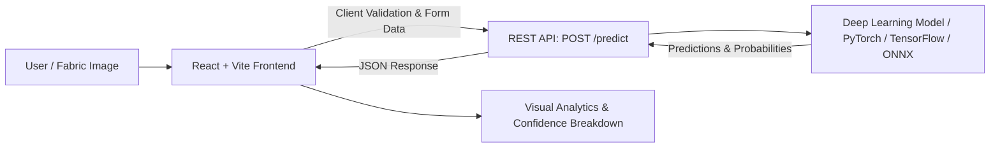

# FabricAI — Fabric Defect Detection & Classification

[](https://reactjs.org/)
[](https://vitejs.dev/)
[](https://tailwindcss.com/)
[](LICENSE)

An AI-driven textile quality assurance and inspection web application. **FabricAI** enables textile manufacturers, quality control teams, and researchers to upload fabric imagery and receive real-time defect classification and confidence analytics powered by deep learning models.

---

## 📌 Table of Contents

- [Overview](#-overview)
- [Key Features](#-key-features)
- [System Architecture](#-system-architecture)
- [Tech Stack](#-tech-stack)
- [Getting Started](#-getting-started)
  - [Prerequisites](#prerequisites)
  - [Installation](#installation)
  - [Running the Development Server](#running-the-development-server)
  - [Building for Production](#building-for-production)
- [Backend API Specification](#-backend-api-specification)
  - [Endpoint: `POST /predict`](#endpoint-post-predict)
  - [Sample Python Backend (Flask)](#sample-python-backend-flask)
- [Project Structure](#-project-structure)
- [Roadmap & Enhancements](#-roadmap--enhancements)
- [License](#-license)

---

## 🌟 Overview

Manual inspection of fabrics in textile manufacturing is labor-intensive, slow, and prone to human fatigue. **FabricAI** automates the defect identification process by analyzing textile surface patterns, weave anomalies, and irregularities. The web interface delivers instant visual feedback, comprehensive probability distributions, and clear defect categorization.

---

## ✨ Key Features

- **Drag-and-Drop Image Upload**: Seamless upload zone supporting JPG, JPEG, and PNG images up to 10MB.
- **Client-Side Validation**: Instant checks for supported file formats and maximum file sizes before transmission.
- **Real-Time Classification & Defect Detection**: Sends fabric images to the ML inference service and renders predictions with minimal latency.
- **Confidence Metrics & Circular Gauge**: Visual representation of prediction confidence scores.
- **Probability Distribution Breakdown**: Dynamic bar charts demonstrating probabilities across all detected defect classes.
- **Clean, Modern Luxe Interface**: Tailored aesthetic utilizing Tailwind CSS, responsive layouts, and accessible navigation.
- **Pluggable API Architecture**: Clean separation between frontend components and backend API services (`src/services/api.js`).

---

## 🏗 System Architecture



---

## 💻 Tech Stack

### Frontend
- **Framework**: [React 18](https://reactjs.org/)
- **Build Tool**: [Vite 5](https://vitejs.dev/)
- **Routing**: [React Router DOM v6](https://reactrouter.com/)
- **Styling**: [Tailwind CSS v3](https://tailwindcss.com/) with PostCSS & Autoprefixer
- **Typography**: Inter (Google Fonts)

### Backend / Inference (Compatible)
- **Frameworks**: Python (Flask, FastAPI, or TorchServe)
- **Model Formats**: PyTorch (`.pt`/`.pth`), TensorFlow/Keras (`.h5`/SavedModel), or ONNX

---

## 🚀 Getting Started

### Prerequisites

Ensure you have the following installed on your machine:
- [Node.js](https://nodejs.org/) (version `18.x` or higher recommended)
- [npm](https://www.npmjs.com/) or [yarn](https://yarnpkg.com/) / [pnpm](https://pnpm.io/)

### Installation

1. **Clone the repository:**
   ```bash
   git clone https://github.com/kanagasuryakumaran-create/fabric-defect-detection.git
   cd fabric-defect-detection
   ```

2. **Install frontend dependencies:**
   ```bash
   npm install
   ```

### Running the Development Server

Start the local Vite development server:
```bash
npm run dev
```

The application will run by default at `http://localhost:5173`.

### Building for Production

Compile optimized production assets:
```bash
npm run build
```

Preview the production build locally:
```bash
npm run preview
```

---

## 🔌 Backend API Specification

The frontend connects to a backend server at `http://localhost:5000` (configurable in `src/services/api.js`).

### Endpoint: `POST /predict`

- **Content-Type**: `multipart/form-data`
- **Body Field**:
  - `image`: Binary image file (`image/jpeg`, `image/png`)

#### Expected Response Format (JSON):
```json
{
  "prediction": "Hole / Tear",
  "confidence": 94.6,
  "probabilities": {
    "Normal / No Defect": 2.1,
    "Hole / Tear": 94.6,
    "Stain / Oil Spot": 1.8,
    "Weft Crack": 1.5
  }
}
```

### Sample Python Backend (Flask)

Here is a minimal reference Flask API that pairs with FabricAI:

```python
from flask import Flask, request, jsonify
from flask_cors import CORS

app = Flask(__name__)
CORS(app)  # Enable Cross-Origin requests from the Vite frontend

@app.route('/predict', methods=['POST'])
def predict():
    if 'image' not in request.files:
        return jsonify({"error": "No image uploaded"}), 400
    
    file = request.files['image']
    
    # Run your ML/DL model inference here:
    # defect_class, confidence, probabilities = model.predict(file)

    # Example response payload:
    return jsonify({
        "prediction": "Normal Fabric",
        "confidence": 98.4,
        "probabilities": {
            "Normal Fabric": 98.4,
            "Hole": 0.8,
            "Stain": 0.5,
            "Color Bleed": 0.3
        }
    })

if __name__ == '__main__':
    app.run(host='0.0.0.0', port=5000, debug=True)
```

---

## 📁 Project Structure

```text
fabric-defect-detection/
├── .gitignore
├── README.md
├── index.html
├── package.json
├── postcss.config.js
├── tailwind.config.js
├── vite.config.js
└── src/
    ├── App.jsx              # Main application shell with routing
    ├── main.jsx             # React DOM root entry point
    ├── index.css            # Tailwind directives and custom utility classes
    ├── components/
    │   ├── ImagePreview.jsx       # Component for rendering uploaded textile previews
    │   ├── LoadingState.jsx       # Animated loading screen during model inference
    │   ├── Navbar.jsx             # Navigation bar with branding
    │   ├── PredictionResult.jsx   # Defect prediction card and gauge visualization
    │   ├── ProbabilityChart.jsx   # Class-by-class probability bars
    │   └── UploadZone.jsx         # Drag-and-drop file upload container
    ├── pages/
    │   ├── Home.jsx         # Landing page introducing FabricAI
    │   ├── Analyze.jsx      # Defect inspection & analysis workflow
    │   └── About.jsx        # Project overview and specs
    └── services/
        └── api.js           # API client and request validation logic
```

---

## 🗺 Roadmap & Enhancements

- [ ] Bounding box defect localization (YOLO / Mask R-CNN heatmaps).
- [ ] Batch processing for automated production line roll analysis.
- [ ] Export inspection reports to PDF / CSV.
- [ ] Multi-lingual support for international manufacturing facilities.

---

## 📄 License

This project is licensed under the [MIT License](LICENSE).
